<!-- Generated by scripts/console/render.mjs from scripts/console/content.mjs and live GitHub data. Edit those, not this file. -->

<a href="https://www.linkedin.com/in/tiagovilasboas/"></a><a href="https://dev.to/tiagovilasboas"></a>
<a href="https://downshift-ai.vercel.app/"></a><a href="https://github.com/sponsors/tiagovilasboas"></a>
<a href="https://downshift-ai.vercel.app/"></a>
<a href="https://dev.to/tiagovilasboas/harness-engineer-como-um-knowledge-base-rag-centralizado-pode-impactar-positivamente-sua-empresa-2ako"></a>
<a href="https://dev.to/tiagovilasboas/10-de-conversao-no-checkout-no-mes-a-campanha-quebrava-na-hora-de-pagar-5566"></a>
<a href="https://dev.to/tiagovilasboas/observabilidade-no-frontend-o-http-200-esconde-900-catch-vazios-53jd"></a>
<a href="https://github.com/openai/openai-agents-python/pull/4961"></a>

<a href="https://github.com/web-infra-dev/rspack/pull/15900"></a>


