<!-- Generated by scripts/console/render.mjs from scripts/console/content.mjs and live GitHub data. Edit those, not this file. -->

<a href="https://www.linkedin.com/in/tiagovilasboas/"></a><a href="https://dev.to/tiagovilasboas"></a><a href="https://downshift-ai.vercel.app/"></a><a href="https://github.com/sponsors/tiagovilasboas"></a>
<a href="https://downshift-ai.vercel.app/"></a>
<a href="https://downshift-ai.vercel.app/"></a><a href="https://downshift-ai.vercel.app/#start"></a><a href="https://downshift-ai.vercel.app/docs/evidence/"></a><a href="https://github.com/tiagovilasboas/downshift-ai"></a>
<a href="https://dev.to/tiagovilasboas/harness-engineer-como-um-knowledge-base-rag-centralizado-pode-impactar-positivamente-sua-empresa-2ako"></a>
<a href="https://dev.to/tiagovilasboas/10-de-conversao-no-checkout-no-mes-a-campanha-quebrava-na-hora-de-pagar-5566"></a>
<a href="https://dev.to/tiagovilasboas/observabilidade-no-frontend-o-http-200-esconde-900-catch-vazios-53jd"></a>
<a href="https://github.com/tiagovilasboas/grok-bot-architecture"></a><a href="https://github.com/tiagovilasboas/antigravity-operator"></a>
<a href="https://github.com/tiagovilasboas/ai-code-review"></a><a href="https://github.com/tiagovilasboas/sentry-golden-path"></a>
<a href="https://github.com/tiagovilasboas/dev-to-mcp"></a><a href="https://github.com/tiagovilasboas/react-layered-boilerplate"></a>
<a href="https://github.com/tiagovilasboas/antigravity-operator/blob/main/docs/ARCHITECTURE.md"></a>
<a href="https://github.com/tiagovilasboas/ai-code-review/blob/main/runbooks/00-overview.md"></a>

<a href="https://www.impacta.edu.br/"></a>
<a href="https://www.coursera.org/account/accomplishments/verify/B27T6TUQO1NB"></a>
<a href="https://www.coursera.org/account/accomplishments/verify/MGL4PB651JCX"></a>
<a href="https://www.coursera.org/account/accomplishments/verify/9EA34R2T1S8S"></a>

